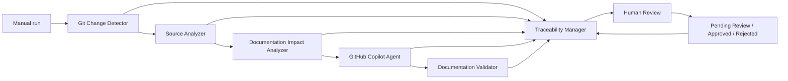

# Automated Documentation Sync — Architecture

## 1. Overview

The system compares a feature branch with its target branch, analyzes changed
Python, Java, and C# source files, and identifies related Markdown and OpenAPI
documentation. GitHub Copilot Agent Mode uses this evidence to generate
documentation proposals. The system validates and records each proposal for
human review.

The implementation is a lightweight Python tool using Git and JSON records.
Generated proposals are distinct from applied file changes. They remain
reviewable as a patch in a controlled proposal output or as changes on a
feature branch; the system never modifies the target branch automatically.
The tool does not commit or merge. Proposals start as `Pending Review`; only
an authenticated, named human decision through the approved GitHub review
process can make one `Approved` or `Rejected`. A JSON approval field is an
audit record only and cannot authorize a merge. GitHub Actions is a possible
future trigger, not required for the initial capstone.

Source code and Git changes are the evidence for documentation updates. If
evidence is incomplete or ambiguous, the system flags the item for human
review instead of inventing technical details.

## 2. Components and responsibilities

1. **Git Change Detector**
   - Uses Git diff between the configured base and head commits.
   - Reports added, modified, and deleted files and relevant change details.
   - Fails the run clearly if the repository or comparison range is unavailable.

2. **Source Analyzer**
   - Analyzes changed Python, Java, and C# files for relevant APIs, classes,
     methods, and symbols.
   - Reports unsupported files and parse failures without treating missing
     analysis as proof of behavior.

3. **Documentation Impact Analyzer**
   - Maps changed source symbols and paths to candidate Markdown and OpenAPI
     YAML/JSON files.
   - Identifies potentially missing or outdated documentation.
   - Flags ambiguous mappings or insufficient evidence for human review.

4. **GitHub Copilot Agent**
   - Uses relevant source changes, candidate documentation, and repository
     instructions to analyze changes, confirm documentation impact, and draft
     proposed updates and a change summary.
   - Must ground proposals in supplied source evidence and must not commit,
     merge, or approve changes.

5. **Documentation Validator**
   - Checks Markdown structure, internal links, and configured required
     sections.
   - Validates OpenAPI YAML/JSON and checks documentation consistency with
     changed API definitions.
   - Before a proposed write, verifies that its target is an allowed
     documentation file resolved within the repository root.
   - Produces actionable errors and warnings for each run.

6. **Traceability Manager**
   - Assigns a proposal ID and records source file paths, base/head commits or
     Git range, relevant diff hunk or API symbol, and affected documentation
     path.
   - Stores the proposal summary, validation results, approval state, reviewer,
     decision, and timestamp in lightweight JSON activity/traceability records.
     Approval fields mirror the authenticated GitHub review; they do not
     authorize changes or merging.

7. **Human Review**
   - Presents proposed changes and validation/traceability records through the
     approved GitHub Pull Request review process.
   - Maintains `Pending Review`, `Approved`, or `Rejected` state based on an
     authenticated, named human decision. Generation, validation, or a JSON
     field alone cannot establish approval or authorize a merge.

## 3. Component diagram

## 4. Basic data flow

1. A developer starts a run and supplies the target and feature branch (or
   equivalent base/head commits).
2. The Git Change Detector identifies changed files and relevant diffs.
3. The Source Analyzer extracts relevant symbols from supported changed files.
4. The Documentation Impact Analyzer selects candidate Markdown/OpenAPI
   files and marks uncertain mappings.
5. GitHub Copilot Agent Mode drafts only evidence-supported documentation
   changes and a summary as a reviewable patch or controlled proposal output.
   Unsupported details are flagged, not guessed. Applying a proposal to a
   feature branch requires an explicit human-controlled action; the system
   never writes to the target branch.
6. The Documentation Validator checks the proposed Markdown and OpenAPI
   content and creates a validation report.
7. The Traceability Manager writes a proposal ID and per-proposal evidence,
   affected paths, validation results, and initial `Pending Review` state to
   JSON records.
8. A named human reviews the proposal, typically through the repository's
   authenticated GitHub Pull Request review process. The Traceability Manager
   records the decision and timestamp in JSON. The JSON record mirrors the
   review and is not authority to merge; the tool does not commit or merge.

## 5. Security and error handling

### Security

- Restrict Git operations and all file reads/writes to the repository context.
- Before writing a proposed file, normalize and resolve its path against the
  repository root. Reject absolute paths, traversal (including encoded
  traversal), and symlinks that resolve outside the root.
- Limit proposals to identified documentation files. Keep generated records
  and temporary outputs inside the repository or an explicitly configured
  repository-scoped run location.
- Use least-privilege access. The initial manual tool needs no GitHub write
  token; any future Actions workflow should start read-only and must not be
  able to commit or merge documentation changes.
- Keep secrets and credentials out of prompts, logs, and reports. Provide the
  Copilot Agent only the relevant repository context and source evidence.
- Treat repository content and agent output as untrusted: validate paths and
  output before writing or presenting proposals.
- Keep generated proposals separate from applied documentation changes. Any
  application to a feature branch is an explicit human-controlled step; never
  write to the target branch automatically.

### Error handling

- Record clear errors and warnings for Git failures, missing files, empty
  change sets, unsupported languages, parsing failures, and validation issues.
- Continue processing independent files when safe; mark skipped or failed
  items in the run record rather than silently dropping them.
- Do not create a proposal from incomplete or ambiguous evidence without
  explicitly flagging it for review.
- Always record the run outcome, including partial completion or termination.
  Avoid logging source contents or sensitive values.

## 6. Testing architecture

Automated tests should cover each component with small fixtures and temporary
repositories:

- Git diff detection for added, modified, and deleted files.
- Source analysis and documentation impact mapping for Python, Java, and C#.
- Path security, including traversal, absolute paths, and symlink escapes,
  verifying that no out-of-repository file is read or written.
- Markdown structure/internal links and valid and invalid OpenAPI YAML/JSON.
- Traceability fields and proposal IDs, plus `Pending Review` to `Approved` or
  `Rejected` transitions. Verify that only an authenticated, named GitHub
  review can establish approval and that a JSON field alone cannot authorize
  merging.

## 7. Technology stack

| Area | Recommendation |
|---|---|
| Implementation | Python |
| Change detection | Git and Git diff |
| Source analysis | Lightweight Python-based analyzers for Python, Java, and C# |
| AI-assisted proposals | GitHub Copilot Agent Mode, with repository instructions where applicable |
| Documentation | Markdown and OpenAPI YAML/JSON |
| Validation | Lightweight Markdown/link checks and an OpenAPI specification validator |
| Traceability and activity | JSON records containing proposal, evidence, validation, and review data |
| Human approval | GitHub Pull Requests and named human review |
| Automation | Optional future GitHub Actions workflow; manual execution is the initial path |

The proposed performance targets, subject to human approval, are to analyze
100 changed source files and produce the proposal summary and traceability
report within 10 minutes, and to validate 100 Markdown/OpenAPI files within
5 minutes. Measure elapsed time on an agreed reference environment; include
comparison, analysis, proposal/traceability, validation, and report generation
as specified by the requirements.

## 8. Requirements mapping

| Requirements | Architecture components |
|---|---|
| **FR-01**, **AC-01** — Detect added, modified, and deleted files by comparing branches | Git Change Detector |
| **FR-02**, **AC-02** — Analyze Python, Java, and C# changes and identify relevant documentation candidates | Source Analyzer; Documentation Impact Analyzer |
| **FR-03**, **AC-03** — Support Markdown and OpenAPI YAML/JSON | Documentation Impact Analyzer; GitHub Copilot Agent; Documentation Validator |
| **FR-04**, **FR-05**, **AC-02** — Identify affected, missing, or outdated documentation and limit changes to relevant docs | Documentation Impact Analyzer; GitHub Copilot Agent |
| **FR-06**, **AC-04** — Preserve existing documentation structure and formatting | GitHub Copilot Agent; Documentation Validator |
| **FR-07**, **FR-08**, **AC-05** — Avoid unsupported assumptions and flag insufficient evidence | Source Analyzer; Documentation Impact Analyzer; GitHub Copilot Agent; Human Review |
| **FR-09**, **AC-06** — Summarize proposed changes | GitHub Copilot Agent; Traceability Manager |
| **FR-10**, **AC-07** — Require human review; no automatic commit or merge | Human Review |
| **FR-11**, **AC-08**, **AC-09** — Validate Markdown, links, required sections, OpenAPI, and API-documentation consistency | Documentation Validator |
| **FR-12**, **AC-08**, **AC-09** — Produce a validation report | Documentation Validator; Traceability Manager |
| **FR-13**, **FR-22**, **AC-12**, **AC-18** — Record activity, required traceability fields, and review decisions | Traceability Manager; Human Review |
| **FR-14**, **FR-15**, **AC-10** — Handle failures clearly and continue unrelated processing where possible | Git Change Detector; Source Analyzer; Documentation Impact Analyzer; Documentation Validator; Traceability Manager |
| **FR-16**, **AC-11**, **AC-11A** — Validate paths and prevent out-of-repository writes | Documentation Validator |
| **FR-17**, **AC-13** — Use Copilot Agent Mode for source-change analysis, impact identification, and proposed updates | GitHub Copilot Agent |
| **FR-18**, **AC-14** — Support manual synchronization | Manual run; all pipeline components |
| **FR-19**, **AC-15** — Optional Actions-triggered synchronization | Future GitHub Actions trigger; same pipeline, subject to a supported Copilot invocation |
| **FR-20**, **FR-21**, **AC-16**, **AC-17** — Link proposals to source evidence and flag missing justification | Traceability Manager; Documentation Impact Analyzer; GitHub Copilot Agent |
| **Non-functional requirements** — Least privilege, confidentiality, relevant-file processing, traceability, and proposed performance targets | All components; security and error-handling controls above |

### Scope note

The initial implementation focuses on manual runs and the three required
languages. GitHub Actions is a future enhancement. Its AI-assisted path should
only be enabled when a supported Copilot invocation is available; it must not
silently produce a different or incomplete result.
